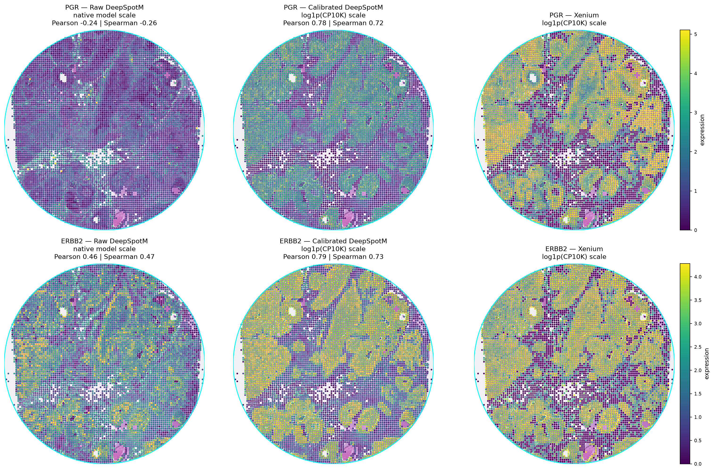

# Calibrated-DeepSpotM

[](https://www.python.org/) [](#) [](#repository-boundaries)

[](https://pytorch.org/) [](https://numpy.org/) [](https://scipy.org/) [](https://pandas.pydata.org/)

[](https://matplotlib.org/) [](https://pyyaml.org/) [](https://pytest.org/) [](#scientific-design)

A reproducible multi-sample pipeline for calibrating DeepSpot-M histology-based
spatial-expression predictions against Xenium measurements.

## Scientific design

- Samples are split at the sample/patient level through `data/sample_manifest.csv`.
- Development samples are used for fitting, normalization, and grouped validation.
- Final-test samples remain untouched until the final evaluation command.
- External bulk RNA-seq, microarray, and scRNA-seq data may provide population-level
  priors only; they are never patient-specific conditioning inputs.
- The first trainable model is DeepSpot-M tile predictions → calibration adapter.
- The legacy notebook is not part of this repository and should remain read-only.

## Observed results

On the pooled final-test samples, the calibration adapter improved overall
agreement with Xenium across the shared genes:

| Metric | Raw DeepSpot-M | Calibrated DeepSpot-M |
|---|---:|---:|
| Spatial Pearson | 0.142 | 0.414 |
| Per-tile gene-rank Spearman | 0.395 | 0.654 |
| Aggregate abundance Pearson | 0.689 | 0.965 |
| Aggregate abundance Spearman | 0.673 | 0.950 |

These are pooled all-gene results. Gene-specific performance varies: EGFR did
not generalize as well on the final test set, so the adapter should not be
interpreted as uniformly improving every gene.

## Scope and expansion

In this evaluation, the calibration adapter improved the reported DeepSpot-M
metrics on a matched human breast-cancer Xenium cohort. The adapter is therefore
breast-cancer-focused rather than a cancer-agnostic replacement for DeepSpot-M.
Adding other cancer types will require additional matched H&E/spatial-expression
training samples, cancer-type-aware grouped validation, and independent external
testing before claiming cross-cancer generalization.

## Setup

```bash
python -m venv .venv
. .venv/bin/activate
python -m pip install -r requirements.txt
```

Copy the manifest template and fill in paths relative to the project root:

```bash
cp data/sample_manifest.template.csv data/sample_manifest.csv
python scripts/preflight.py --manifest data/sample_manifest.csv
```

The preflight command validates sample-level split separation and required paths.
It does not download data, extract archives, fit a model, or train anything.

## Repository boundaries

Raw Xenium bundles, H&E images, DeepSpot-M weights, processed matrices, and
experiment results are intentionally excluded by `.gitignore`. Store them locally
and record their relative paths in the manifest.

## Validation

```bash
python -m compileall -q src scripts tests
pytest -q
```

See [docs/multisample_design.md](docs/multisample_design.md) for alignment,
normalization, split, evaluation, and leakage-control details.

## Example visualization

The following S4-Mid visualization compares PGR and ERBB2 spatial patterns on a
large H&E cookie-shaped region:


